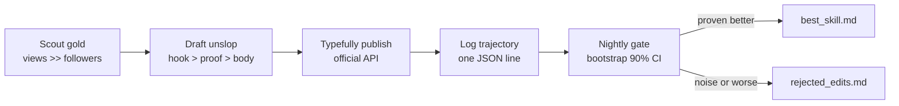

# grokbot-x

[](https://github.com/YannisKiefer/grokbot-x/actions/workflows/ci.yml)
[](LICENSE)

**Self-learning X/Twitter growth system for Grok Bot.**

Most X agent repos give you a prompt pack that spams compose and hopes.
This is the other thing: scout posts that actually move, draft like a
human, publish through the official Typefully API, log every ship as a
trajectory, and let a nightly gate rewrite the playbook only when the
numbers prove the edit helped. No runtime dependencies. Python 3.10+
stdlib only.

Built for tired founders. Dumbed down on purpose.

## How it works



Two lanes, never mixed:

- **Publish lane.** Originals go out via the Typefully API. Replies are
  created as Typefully drafts, and a human clicks Publish NOW after
  reading them. That human click is the whole compliance model: official
  clients only, no scripted browser on x.com (X's automation rules
  ban scripting the site), no bulk or unsolicited automated replies, no
  auto-likes or auto-follows. Whether posts carry the "Made with AI"
  disclosure is your choice (`X_MADE_WITH_AI` in `.env`).
- **Learning lane.** `skillopt/best_skill.md` is the trainable state.
  The reward is fixed in code, so no edit can win by rewriting it. The
  nightly gate judges held-out trajectories only (a live trial of the
  proposed skill, or a replay of its targeting rule), computes a bootstrap
  90% interval on the improvement, and adopts an edit only if the lower
  bound is above zero. Everything else lands in `rejected_edits.md`.
  You can replay two targeting rules offline before touching the live one:
  `python3 skillopt/sleep_cycle.py replay --skill-a A.md --skill-b B.md`.

## Quickstart (5 minutes, clean machine)

No pip install. Nothing to build. Python 3.10 or newer.

```bash
# 1. Environment: three values (Typefully -> Settings -> API + Development mode)
cp .env.example .env
# edit .env: YOUR_TYPEFULLY_API_KEY, YOUR_TYPEFULLY_SOCIAL_SET_ID, YOUR_HANDLE

# 2. Training wheels: example data so you can see the scorer work
cp examples/best_skill.starter.md skillopt/best_skill.md
cp skillopt/held_out.example.json skillopt/held_out.json
cp examples/trajectories.example.jsonl skillopt/trajectories.jsonl
python3 skillopt/sleep_cycle.py status

# 3. Your first original (needs the real API key from step 1)
python3 scripts/publish_original.py --text "your copy, hard first line"

# 4. Your first reply: creates a DRAFT, you publish it in the Typefully UI
python3 scripts/create_reply_draft.py --text "the missing next step" \
  --reply-to https://x.com/someone/status/0123456789012345678

# 5. Log the ship (same shape as examples/trajectories.example.jsonl)
python3 skillopt/sleep_cycle.py append --json '{"id":"d1","ts":"2026-11-08T10:00:00Z","type":"original","text":"...","features":{},"metrics":{},"split":"train"}'
```

Then:

1. Fill `docs/BRAND-BIBLE.template.md` so drafts know what you sell.
2. Drop the five `skills/*/SKILL.md` files into your Grok Bot skill folder.
3. Follow `docs/PLAYBOOK.md` daily. Replace the example trajectories with
   your own once real posts are logged.

No key, no publish: the scripts exit with a clear error and nothing is
drafted to Typefully.

## What each file does

| Path | What |
|---|---|
| `docs/PLAYBOOK.md` | start here: the daily loop |
| `docs/PUBLISH.md` | Typefully originals vs replies, allowed vs forbidden |
| `docs/x-post-guide.md` | writing posts for the current algo weights |
| `docs/x-human-cadence.md` | timing, jitter, volume discipline |
| `docs/SKILLOPT.md` | the nightly gate, scorer reference |
| `docs/OPERATOR.md` | voice and targeting rules |
| `docs/BRAND-BIBLE.template.md` | fill-in product doctrine |
| `skills/` | five Grok Bot SKILL.md files |
| `skillopt/sleep_cycle.py` | scorer, gate, replay eval (offline) |
| `skillopt/best_skill.md` | deployed skill; edit only via the gate |
| `scripts/publish_original.py` | publish an original via Typefully |
| `scripts/create_reply_draft.py` | create a reply draft for human publish |
| `examples/` | fake trajectories + starter skill |

Env vars: `YOUR_HANDLE`, `YOUR_TYPEFULLY_API_KEY`,
`YOUR_TYPEFULLY_SOCIAL_SET_ID` (or `YOUR_SOCIAL_SET_ID`), optional
`SKILLOPT_DIR` and `X_MADE_WITH_AI` (set `true` to disclose; default off).

## What NOT to do

- No browser automation on x.com. X bans scripting the site; that is the
  one rule this kit will not help you break.
- No bulk or unsolicited automated replies. Every reply needs a human
  click after a human read.
- No filler originals to fill an hour. Bank the slot.
- No engagement groups, no bought engagement, no "like my post" bait.
- Do not hand-edit `skillopt/best_skill.md` around the gate. That file is
  the model's training data; unmeasured edits are how the loop dies.
- Do not commit `.env`, real trajectories, or real handles. The
  gitignore already blocks the skillopt data files.

## Development

```bash
pip install ruff pytest
ruff check .
pytest
```

Contributing: `CONTRIBUTING.md`. Security: `SECURITY.md`.
Changelog: `CHANGELOG.md`.

## License

MIT. Copyright 2026 Grok Bot X contributors.

## Disclaimer

Not affiliated with xAI, X/Twitter, Typefully, or Microsoft.
Educational kit. Do not spam. Human cadence is required. You are
responsible for what you publish and for staying inside each platform's
rules. No growth numbers are claimed here. Run it, log your own.
